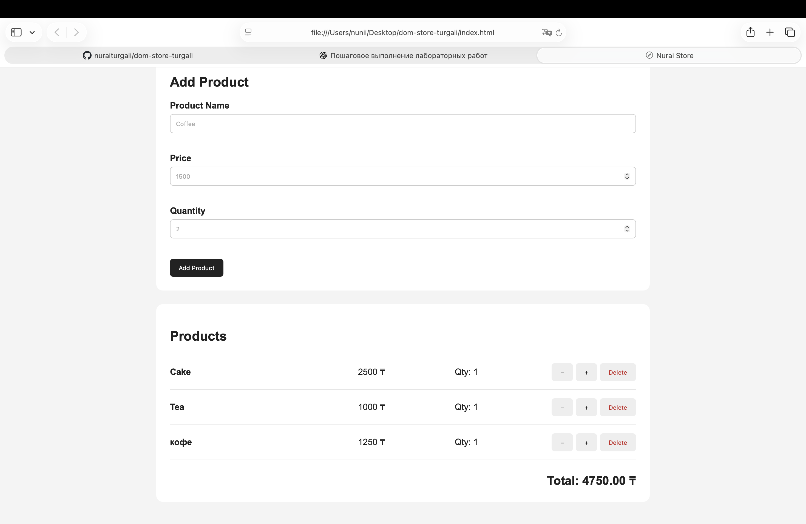

# DOM Store — Lab 5

A simple interactive product manager built with JavaScript and the DOM API.

## How to Open

Open `index.html` in a web browser.

## Features

- Render products from the Store class
- Add new products
- Validate the form and display errors in the DOM
- Delete products
- Increase and decrease product quantity
- Calculate the total price automatically
- Update the page without reload
- Use event delegation for product actions

## Events

I used the `submit` event to handle the add-product form and prevent the page from reloading. I used the `click` event to handle delete and quantity changes. Event delegation allows one listener on the product list to handle actions for all products. After every change, the product list and total are updated automatically.

## Screenshot

